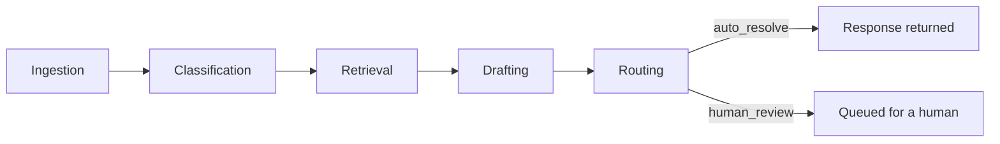

# TriageAI

A production-oriented agent harness for IT support ticket triage: classify,
retrieve grounded evidence, draft a cited response, and route low-confidence
or high-risk tickets to a human — instead of a single opaque LLM call.

Built with Clean Architecture, a Repository Pattern over pluggable storage
(Chroma + Neo4j), dependency injection via FastAPI, and a provider-agnostic
LLM layer (Ollama by default, OpenAI as a config-driven alternative).

## Why this exists

Most "LLM does the ticket" demos skip the part that actually matters in
production: knowing when *not* to trust the model. This project's core bet
is a routing policy that sends a ticket to a human whenever the model is
unconfident, the draft cites nothing it can back up, or the category is
inherently security-sensitive — regardless of how fluent the response
sounds. See [`docs/architecture.md`](docs/architecture.md) for the full
design rationale and every trade-off made along the way.

## What's actually measured, not claimed

Every number below comes from `eval/run_evaluation.py`, is reproducible by
running it yourself, and is labeled with which LLM provider produced it. Full
reports: [`eval/results/fake_report.md`](eval/results/fake_report.md) (pipeline
wiring, deterministic) and
[`eval/results/ollama_report.md`](eval/results/ollama_report.md) (real
`llama3.1:8b`, CPU-only local inference).

| Metric | `fake` provider (keyword rules) | `ollama` provider (real `llama3.1:8b`) |
|---|---|---|
| Classification accuracy | 76.7% | 75.0% |
| Retrieval recall@k | 100.0% | 100.0% |
| Groundedness rate | 76.7% | **0.0%** |
| Hallucination rate | 23.3% | **100.0%** |
| Escalation recall | 61.8% | 100.0% |
| Latency (mean / p95) | 109ms / 156ms | **192s / 308s** |

Both runs: 60 synthetic tickets, 10 synthetic KB docs, 60/60 completed.

**The `ollama` column is not a bug — it's the v1 groundedness heuristic's
documented limitation showing up exactly as predicted against a real,
verbose model.** `llama3.1:8b` writes full formatted replies ("Dear User,
Thank you for reaching out... Best regards, IT Support"); the per-sentence
citation checker (`domain/groundedness.py`) correctly flags every
uncited greeting and closing as unsupported, because it is — a real NLI
model would recognize those sentences as filler rather than claims, this
v1 heuristic doesn't. That gap between heuristic and reality is stated
explicitly as a limitation in `docs/architecture.md`, written *before* this
run existed to confirm it.

**What that gap does not do is break the safety property this whole project
is built around: even at a 0% measured groundedness rate, 100% of tickets
still correctly routed to human review** (escalation recall 100%) — the
system never confidently auto-resolved something it couldn't back up. A
naive "does it sound confident" check would have shipped these responses;
the routing policy didn't, because it doesn't trust fluency.

**The latency number is the other real finding worth not glossing over:**
~192s mean, ~308s p95, on CPU-only local inference with no GPU. That's the
honest cost of running a 7-8B model without acceleration, and it's the
reason `eval/results/ollama_report.md` flags an open question its own data
can't resolve: latency variance that wide (mean 192s vs. max 317s) is
consistent with a small number of the 60 "completed" runs having hit the
retry-exhaustion fallback path rather than a genuine model response, and this
run predates the per-ticket logging (`ollama_raw.jsonl`) that would confirm
or rule that out — added *because* reviewing these results surfaced the gap.
A re-run with the current script answers it directly.

## Architecture



Full diagrams (layer dependency graph, request sequence diagram) and every
design decision behind them are in
[`docs/architecture.md`](docs/architecture.md).

## Stack

Python 3.11 · FastAPI (async) · LangGraph · LangChain · Neo4j (graph memory)
· Chroma (vector search) · Pydantic v2 · pytest · Docker Compose ·
GitHub Actions · structured JSON logging (`structlog`) · OpenTelemetry-ready
request IDs and latency instrumentation

## Quickstart

### Option A — Docker Compose (Neo4j + Ollama + the app)

```bash
cp .env.example .env
docker compose up -d
docker compose exec ollama ollama pull llama3.1:8b
curl http://localhost:8000/healthz
```

### Option B — local Python, no Docker

```bash
python -m venv .venv && source .venv/bin/activate
pip install -e ".[dev,ollama,openai]"
python scripts/generate_synthetic_tickets.py
TRIAGEAI_LLM_PROVIDER=fake uvicorn triageai.infrastructure.api.main:app --reload
```

This runs with the deterministic fake provider and an in-memory graph
repository by default — no external services required to see it work.

### Try it

```bash
curl -X POST http://localhost:8000/tickets \
  -H "Content-Type: application/json" \
  -d '{
    "subject": "Locked out of my account",
    "body": "I typed my password wrong too many times and now Im locked out.",
    "requester_email": "user@example.com"
  }'
```

Full request/response examples and every endpoint: [`docs/api.md`](docs/api.md).

## Development

```bash
pip install -e ".[dev,ollama,openai]"
pre-commit install

ruff check src tests scripts eval       # lint
ruff format src tests scripts eval      # format
mypy src                                # type check
pytest tests/ -v                        # unit + integration (integration tests
                                         # skip with an explicit reason if
                                         # Neo4j/Ollama aren't reachable)
python eval/run_evaluation.py           # regenerate eval/results/{provider}_report.md
                                         # (provider from TRIAGEAI_LLM_PROVIDER, default fake)
```

## Testing philosophy

Integration tests for Neo4j and Ollama **skip with an explicit reason**
when those services aren't reachable — they are never mocked into a false
green. A skipped suite is an honest, visible signal; a green suite that
quietly tested nothing is not. Run `docker compose up` first to exercise
the full integration suite for real.

## Known limitations

- **Groundedness detection is a v1 heuristic** (citation + lexical overlap),
  not an NLI model — see the trade-off writeup in `docs/architecture.md`.
- **Escalation precision/recall are measured against this project's own
  routing policy**, not an external ground truth — there isn't one for
  synthetic data. The definition is stated explicitly in `eval/metrics.py`.
- **JWT auth, RBAC, rate limiting, Redis caching, and background workers are
  documented as future work, not built** — seeing a table of exactly where
  each would plug in and why it wasn't needed for this project's scope is in
  `docs/architecture.md`'s "Production-readiness" section.
- **Docker build/compose and the Neo4j/Ollama integration suite are verified
  in CI, not necessarily on every contributor's machine** — see
  `.github/workflows/ci.yml`.

## License

MIT — see [LICENSE](LICENSE).
