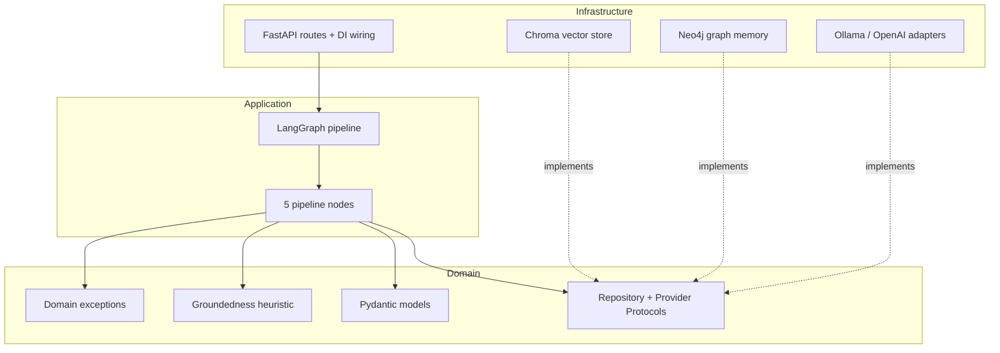
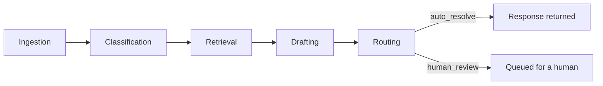
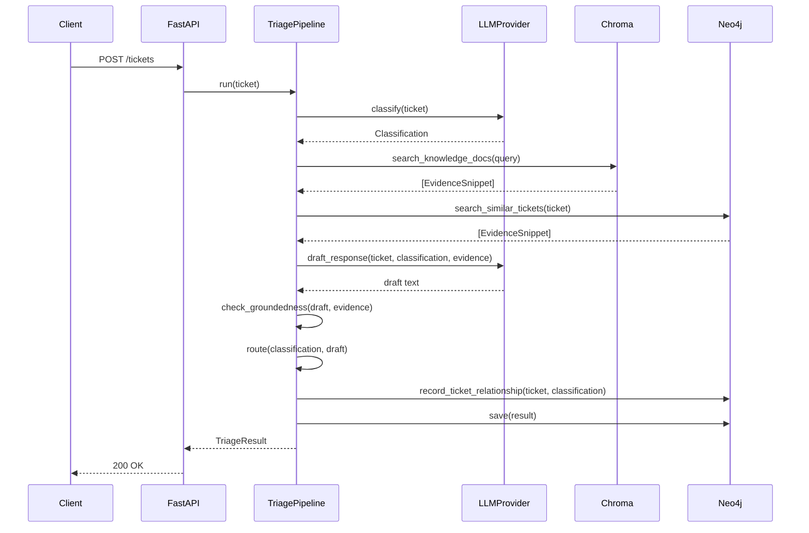

# Architecture

## Layers

TriageAI follows Clean Architecture's dependency rule: dependencies point
inward, only. `domain/` never imports from `application/` or
`infrastructure/`; `application/` never imports a concrete class from
`infrastructure/` — only the Protocols defined in `domain/interfaces.py`.

The only place that knows about concrete infrastructure classes at all is
`infrastructure/api/dependencies.py`. Swapping the in-memory graph
repository for the real Neo4j one — or `fake` for `ollama` for `openai` —
is a one-line change there, controlled by `config.py`'s environment
variables. Nothing in `domain/` or `application/` changes.

## Pipeline

- **Ingestion**: normalizes the ticket (whitespace, email casing), starts the latency timer.
- **Classification**: LLM call → category, urgency, confidence.
- **Retrieval**: Chroma semantic search over KB docs + Neo4j full-text search over past tickets, merged and ranked by similarity.
- **Drafting**: LLM drafts a response citing evidence by ID; a groundedness check verifies every sentence is actually supported by cited evidence.
- **Routing**: rule-based — low confidence, any unsupported claim, or a security-sensitive category (access/account) → human review, regardless of how confident the model was.

## Request sequence

## Design decisions and trade-offs

**Repository Pattern over a direct Chroma/Neo4j dependency.** Every stage
that touches storage or retrieval depends on a `Protocol`
(`VectorSearchRepository`, `GraphMemoryRepository`, `TicketRepository`), not
a concrete class. This is why Neo4j could be added in a later phase without
touching `application/nodes/*` at all — the in-memory stand-ins and the real
Neo4j classes satisfy the same interface.

**DI via FastAPI's native `Depends`/`Annotated`, not a custom container.**
A hand-rolled DI container adds a dependency and a learning curve for
roughly the same result `Depends` already gives for free in this size of
service. Reach for a container (e.g. `dependency-injector`) if the object
graph gets substantially more complex than this.

**Groundedness is a citation-and-lexical-overlap heuristic, not an NLI
model (v1).** Every sentence in a draft must cite an evidence ID and share
enough content words with that evidence to count as supported. This is
fully explainable and has zero inference cost, but it will both
false-positive (a paraphrase with different words gets flagged) and
false-negative (word-salad that happens to overlap gets through) more often
than a real entailment model would. The upgrade path is a drop-in
replacement: `check_groundedness(draft, evidence) -> GroundednessCheck`
keeps the same signature if backed by an NLI model instead.

**Escalation precision/recall are measured against our own routing policy,
not an external ground truth.** There's no oracle for "a human should have
looked at this" on synthetic data. `eval/metrics.py` defines "should
escalate" as: misclassified vs. the synthetic ground-truth category, an
inherently high-risk category (access/account), or an ungrounded draft.
That's a deliberate, stated definition — not a claim about real-world
correctness.

**LLM provider is pluggable, Ollama is the default.** `domain/interfaces.py`
defines `LLMProvider`; `infrastructure/llm/provider_factory.py` selects an
implementation from `TRIAGEAI_LLM_PROVIDER`. Ollama is the default because
it's free, fully local, and reproducible — anyone cloning this repo can run
the full pipeline without an API key. OpenAI is wired in as the first cloud
option. Anthropic and Azure OpenAI are not implemented, but adding either is
exactly the same shape of change as `openai_provider.py`: one new adapter
class satisfying `LLMProvider`, one new branch in `provider_factory.py`.

**Safe degradation, not silent failure, when the LLM is unavailable.**
`infrastructure/llm/resilience.py` retries transient failures (timeout,
connection errors) with exponential backoff, then raises
`LLMUnavailableError`. `ClassificationNode` and `DraftingNode` catch that
and fall back to a zero-confidence classification / an explicitly-labeled
"couldn't generate a response" draft — both of which the routing stage's
existing rules send to human review. The outage degrades the system to
"everything goes to a human," not to a crash or a hallucinated response.

## Production-readiness: what's built vs. documented as future work

This project deliberately scoped to Clean Architecture + DI + Repository
Pattern + observability basics + multi-provider LLM support (all built and
tested) rather than also building JWT auth, RBAC, Redis-backed rate
limiting, and a background-worker queue for a solo portfolio project with
no real multi-tenant traffic to protect. Building those without a real need
for them would be exactly the kind of unmotivated enterprise machinery that
reads as checkbox-driven rather than judgment-driven. Here's what each would
look like if the system needed it, and where it plugs in:

| Feature | Where it would plug in | Why it's not built here |
|---|---|---|
| JWT authentication | A FastAPI dependency added to the `PipelineDep`/`TicketRepoDep` chain in `infrastructure/api/routes.py`, validating a bearer token before the request reaches a route | No multi-tenant access control need for a single-operator portfolio service |
| RBAC | An authorization check alongside JWT, gating e.g. who can view another user's ticket via `GET /tickets/{id}` | Same as above — no distinct roles exist yet to authorize between |
| Rate limiting | `slowapi` (Redis- or in-memory-backed) as FastAPI middleware, ahead of the existing request-context middleware in `main.py` | No public-facing traffic to protect against abuse |
| Redis caching | A cache-aside layer in front of `ChromaKnowledgeRepository.search_knowledge_docs` for repeated queries | KB doc set is small (10 synthetic docs); no measured latency problem it would solve |
| Background workers | Celery/RQ/arq consuming ticket-triage jobs off a queue, with `POST /tickets` returning `202 Accepted` + a job ID instead of blocking | Current p95 latency is ~170ms end-to-end (see `eval/results/latest_report.md`) — nothing here is slow enough to justify async processing yet |
| Audit logging | A dedicated `audit_log` write (actor, action, timestamp) in `Neo4jTicketRepository.save`, separate from the structured request logs already in place | Structured JSON logs with request IDs already capture every classification/routing decision; a dedicated audit trail is the next step if this became a real compliance-relevant system |
